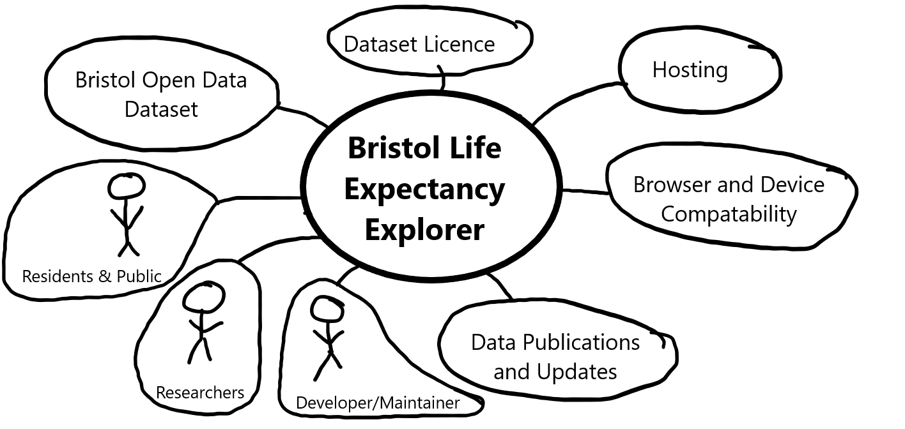

# Project Proposal

## Business Case

### Problem statement
Life expectancy varies between neighbourhoods within the same city. Understanding these differences require information that is easy to access and compare. However, the raw format of the Life Expectancy at birth in Bristol by Ward dataset can be difficult for users to examine and understand these differences between wards.
The proposed web application will aid users in exploring this information through clear interactive charts and tools. By presenting life expectancy estimations visually, comparisons will be much easier for the user to make.

### Business benefits
The application will make Bristol's ward-level life expectancy data easier to explore and understand. Its main benefits will include:
1) Greater Public Understanding
   - Visual comparisons will help users understand and interpret life expectancy estimates without needing any special skills or tools. It saves users the hassle of trying to filter and sort data from a raw dataset.
2) Providing a Clearer Picture of Bristol
   - Users will be able to explore differences between wards that could be overlooked when viewing the city as a whole.
3) A Starting Point for Further Investigation
   - Users can identify differences worth researching, for example somebody looking to move to Bristol will be able to ask their own questions and identify using the application where a good place to settle may be. Or it may be a researcher trying to understand why a certain neighbourhood could provide a different outcome in any scenario.
4) More Useful Public Data
   - The application will give residents a practical way to explore published statistics about their local area.

### Options Considered
There are multiple approaches to meet the users' needs for accessing, understanding and comparing life expectancy estimates across Bristol's wards.

Option 1: Using Microsoft Excel
Users can download the dataset and use Microsoft spreadsheet tools to sort values, compare wards and create charts manually. 
Advantages:
- Very flexible on what/how they can use the data.
- Familiar to many users and suitable for calculations and detailed analysis. 
Disadvantages:
- Requires knowledge of spreadsheets and visualisation tools.
- Users will have to create their own comparions and visualisations manually.

Option 2: Using the existing Bristol Open Data Platform.
Users can access the dataset directly through the existing online platform. Reading data off a raw spreadsheet or using provided tools. 
Advantages:
- Readily available, requires no development of any applications and provides access to the published source. 
Disadvantages:
- Users may still need to interpret the data themselves.
- The platform can offer less guidance than a dedicated application designed specifically for life expectancy comparisons.

Option 3: Custom Web Application
A dedicated website tailored to display life expectancy data across Bristol's wards dataset using charts, graphs, maps and other visualisations. 
Advantages:
- Simple and user friendly interface designed for the target audience.
- Interactive visualisations creates to make data easier to understand.
- Accessible through a web browser without the need for any specialist data analysis softwares. 
Disadvantages:
- Data may need updating when new statistics are released/updated.
- Requires an internet connection in order to access the website.

Factoring in these option it makes most sense for the user to use our proposed web application solution. This is because the application is specifically designed around the Open Bristol's Life Expectancy by Ward dataset, including features that are made to explain this dataset in any way possible.

### Expected Risks
The project has several risks that could affect the accuracy of the information and the completion of the application. These will need to be considered during the planning, development and testing stages.

Risk 1: Accuracy of Displayed Data
Mistakes may occur when preparing or importing the dataset leading to incorrect values appearing in the application. For example, figures being linked to the wrong ward, missing values treated as zero, or charts displaying information incorrectly. These errors would reduce the reliability of the application.

2. Misunderstanding Life Expectancy
Some users may interpret a ward’s life expectancy estimate as a prediction of their own lifespan. They may also assume that differences between wards prove the effects of particular social or environmental factors, even though the dataset alone cannot establish those causes.

3. Misleading Comparisons
Comparisons could be misleading if the selected figures cover different reporting periods or population groups. Small differences between estimates could also appear more significant than they are, particularly if uncertainty is not explained or chart scales exaggerate the gap.

4. Technical Difficulties
Developing interactive charts and filters using JavaScript may present challenges. A fault could cause a chart to show the wrong selection or fail to update. Differences between browsers and screen sizes could also affect how the application looks and functions.

5. Time Constraints
The project requires time for data preparation, planning, design, requirements and testing. If a feature takes longer than expected, there may be less time to complete other essential parts of the application. Adding too many features could make it difficult to deliver a finished product by the deadline.

6. Usability and Accessibility
Displaying several wards in one chart could make labels crowded and comparisons difficult to follow. Small text, unclear navigation or reliance on colour alone could create barriers for some users. A layout that works well on a desktop may also be difficult to use on a mobile device.

7. Outdated Information
Open Data Bristol may release new estimates after the dataset has been downloaded. If the application continues to use an older version without clearly identifying its reporting period, users could mistake historical figures for the latest available information.

## Project Scope
TODO: Scope of the System of Interest. Include a bullet list of things from your context diagram that are in scope.

