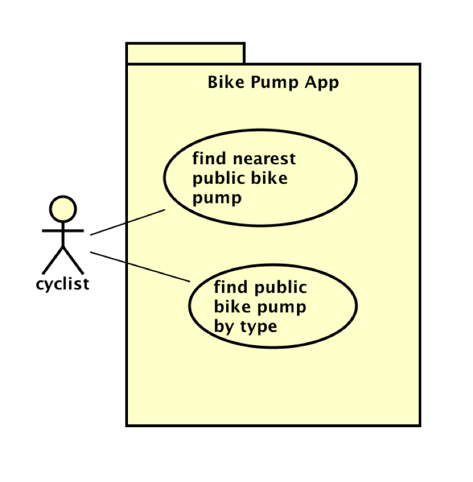

# Requirements

## User Needs

### User stories
As a Bristol resident, I want to select my ward so that I can view its life expectancy estimates.
As a member of the public I would like to compare wards in clear charts so that I can understand the differences across Bristol.
Being a student, I want to sort wards by life expectancy so that I can identify patterns patterns for my coursework.
As a researcher and working with large datasets, I want to view exact figures in a data table so that I can check the values shown in charts. I also would like to see the data source and reporting periods so that I can judge whether or not this data is suitable for my investigations.
As a general user, I have no history working with data in the past so I would like a clear explanation of life expectancy at birth so that I can interpret the estimates correctly.
As a maintainer, I need a documented process for replacing the dataset so that I can keep the application up to date.

### Actors
Bristol residents and the general public: People interested in life expectancy in their local areaa. They will need to select wards, view summaries and compare estimates across Bristol.
Students: Users exploring the data for coursework, they will use charts and tables to investigate geographical differences and understand the Bristol populations health statistics.
Researchers: Users who need to examine the data and figures more closely. They will view exact values, compare wards and work with the source information and limitations to assess whether the data supports their investigations.
Maintainer/Developer: The person who is responsible for maintaining the application, fixing faults and replacating the dataset when updates become available.

### Use Cases
TODO: Describe each use case (at least one per team member).
    Give each use case a unique ID, e.g. UC1, UC2, ...
    Summarise these using the use-case template below.

| TODO: USE-CASE ID e.g. UC1, UC2, ... | TODO: USE-CASE NAME | 
| -------------------------------------- | ------------------- |
| **Description** | TODO: Goal to be achieved by use case and sources for requirement |
| **Actors** | TODO: List of actors involved in use case |
| **Assumptions** | TODO: Pre/post-conditions if any</td></tr>
| **Steps** | TODO: Interactions between actors and system necessary to achieve goal |
| **Variations** | TODO: OPTIONAL - Any variations in the steps of a use case |
| **Non-functional** | TODO: OPTIONAL - List of non-functional requirements that the use case must meet. |
| **Issues** | TODO: OPTIONAL - List of issues that remain to be resolved |

TODO: Your Use-Case diagram should include all use-cases.

## Software Requirements Specification
### Functional requirements
TODO: create a list of functional requirements. 
    e.g. "The system shall ..."
    Give each functional requirement a unique ID. e.g. FR1, FR2, ...
    Indicate which UC the requirement comes from.

### Non-Functional Requirements
TODO: Consider one or more [quality attributes](https://en.wikipedia.org/wiki/ISO/IEC_9126) to suggest a small number of non-functional requirements.
Give each non-functional requirement a unique ID. e.g. NFR1, NFR2, ...

Indicate which UC the requirement comes from.
