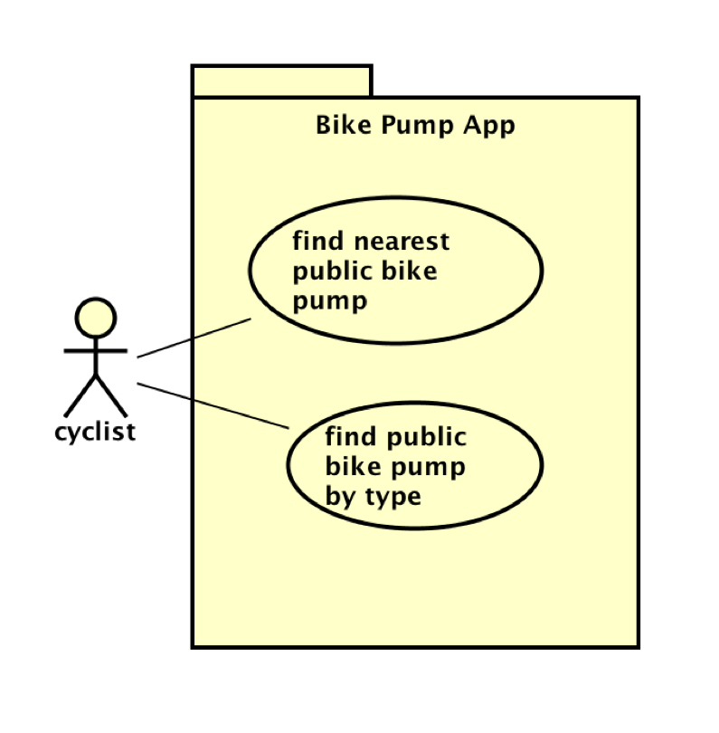

# Requirements

## User Needs

### User stories
As a Bristol resident, I want to select my ward so that I can view its life expectancy estimates. 
As a member of the public I would like to compare wards in clear charts so that I can understand the differences across Bristol. 
Being a student, I want to sort wards by life expectancy so that I can identify patterns patterns for my coursework. 
As a researcher and working with large datasets, I want to view exact figures in a data table so that I can check the values shown in charts. I also would like to see the data source and reporting periods so that I can judge whether or not this data is suitable for my investigations. 
As a general user, I have no history working with data in the past so I would like a clear explanation of life expectancy at birth so that I can interpret the estimates correctly. 
As a maintainer, I need a documented process for replacing the dataset so that I can keep the application up to date. 

### Actors
Bristol residents and the general public: People interested in life expectancy in their local areaa. They will need to select wards, view summaries and compare estimates across Bristol. 
Students: Users exploring the data for coursework, they will use charts and tables to investigate geographical differences and understand the Bristol populations health statistics. 
Researchers: Users who need to examine the data and figures more closely. They will view exact values, compare wards and work with the source information and limitations to assess whether the data supports their investigations. 
Maintainer/Developer: The person who is responsible for maintaining the application, fixing faults and replacating the dataset when updates become available. 

### Use Cases
TODO: Describe each use case (at least one per team member).
    Give each use case a unique ID, e.g. UC1, UC2, ...
    Summarise these using the use-case template below.

| UC1 | View Ward Life Expectancy | 
| -------------------------------------- | ------------------- |
| **Description** | Let a user select a ward in Bristol and view the estimated life expectancy at birth |
| **Actors** | Bristol residents, general user/public |
| **Assumptions** | The application has a database containing this information</td></tr>
| **Steps** | 1) User opens application. 2) User selects ward 3) System retrieves this data from database. 4) Life expectancy is presented to the user. |
| **Variations** | If the data is unavailable or the ward doesn't exist the system will display a relevant message |
| **Non-functional** | Information must be clear to view |

| UC2 | Compare Ward Life Expectancy | 
| -------------------------------------- | ------------------- |
| **Description** | Allow users to select two wards and compare their life expectancy at birth. |
| **Actors** | Bristol residents, general user/public, students, researchers |
| **Assumptions** | There is life expectancy data for more than one ward.</td></tr>
| **Steps** | 1) User selects the 'Compare' tab. 2) User inputs two wards. 3) System retrieves data for both wards. 4) System displays the life expectancies and shows a brief comparison of their values. |
| **Variations** | User will have to select two specific wards rather than comparing all. |
| **Issues** | Which kind of chart/table would be best for this case? |
| **Non-functional** | Charts should be clearly readible and labelled. |

| UC3 | Sort Wards by Life Expectancy | 
| -------------------------------------- | ------------------- |
| **Description** | Lets the user sort data by life expectancy to identify patterns. This one is based on the student's user story. |
| **Actors** | Students, Researchers |
| **Assumptions** | The table contains numerical data, in this case life expectancy in number of years.</td></tr>
| **Steps** | 1) Users opens 'All Wards' tab. 2) User selects a sorting option. 3) System sorts wards by life expectancy. 4) Display the data to the user. |
| **Variations** | Users can sort from lowest to highest or highest to lowest. |
| **Non-functional** | Sorting should be responsive and display correct results. |

| UC4 | Update Application Dataset | 
| -------------------------------------- | ------------------- |
| **Description** | Allow the maintainer/developer to replace the existing dataset when a new one is released by Open Data Bristol. This will follow a procedure. |
| **Actors** | Maintainer/Developer |
| **Assumptions** | The new dataset is in a compatible format, and the maintainer has access to project files.</td></tr>
| **Steps** | 1) Maintainer acquires new dataset. 2) Maintainer follows procedure to replace the old dataset. 3) Maintainer ensures all data displays correctly. |
| **Variations** | If the dataset changes format then a necessary response will need to be taken - e.g. modifying code or data. |
| **Non-functional** | Updates should not cause data corruption or display incorrectly on the application. |
| **Issues** | Will dataset replacement be a manual prodcedure or automated? |

TODO: Your Use-Case diagram should include all use-cases.

## Software Requirements Specification
### Functional requirements
TODO: create a list of functional requirements. 
    e.g. "The system shall ..."
    Give each functional requirement a unique ID. e.g. FR1, FR2, ...
    Indicate which UC the requirement comes from.

### Non-Functional Requirements
TODO: Consider one or more [quality attributes](https://en.wikipedia.org/wiki/ISO/IEC_9126) to suggest a small number of non-functional requirements.
Give each non-functional requirement a unique ID. e.g. NFR1, NFR2, ...

Indicate which UC the requirement comes from.
